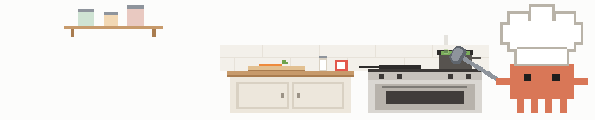

# Martha

**MARTHA** = **M**eal **A**ssistant **R**outes **T**o **H**ome **A**ddress

<picture>
  <source media="(prefers-color-scheme: dark)" srcset="docs/chef-clawd/kitchen-fire-dark.gif">
  
</picture>

<sub>Chef Clawd, the optional mod in this repo, cooking while Martha works. Chef Clawd is an unofficial fan mod. Clawd and Claude are Anthropic's; this project is not affiliated with or endorsed by Anthropic.</sub>

Martha is a Claude skill that plans your household's week of meals and fills your Kroger cart. Each week it asks how last week's meals went, checks what's on sale at your store, plans dinners, salads and breakfasts around everyone's diet and your budget, writes the plan and the shopping list, and adds every item to your Kroger cart. You look over the cart and place the order yourself.

The cart needs a Kroger store in the US. Kroger's API also lists its family stores (Ralphs, King Soopers, Fred Meyer and others), which haven't been tried. Without Kroger, Martha still plans the week and writes a shopping list for any store.

## What it does

- **Asks for feedback first.** Every run opens with one message about last week's meals, and the answers shape the next plan: loved dishes come back, disliked ingredients don't.
- **Plans for your household.** Each person's diet and allergies, child-sized portions, a weekly budget ceiling, how often a dish may repeat, and a 30-minute cooking limit at the batch size you actually cook.
- **Shops the sales.** It searches your store's current prices and promotions and builds the week around them.
- **Takes recipes from you.** Drop a recipe link in chat, or pin recipes to a Pinterest board (optional). A note on a pin ("double it", "no cilantro") is read as an instruction.
- **Buys the right amounts.** Quantity math turns recipes into package counts, and pre-cut produce is preferred where it saves a cooking step.
- **Optional nutrition standard.** Plans can follow the [ZOE](https://zoe.com) approach of 30 different plants a week, or a macro target, or neither.
- **Writes the plan where you'll see it.** A plan file in your profile folder, and optionally an Apple Note. It can also read your Alexa shopping list into the cart and check off what it added.
- **Takes notes by voice (optional).** Through an Alexa skill of your own, anyone in the house can say "Alexa, tell Martha Meal we're out of cumin" or "Alexa, tell Martha Meal Sam loved the chili"; the notes wait in your own AWS account, and the next run shows each one and files it. Setup: [VOICE-SETUP.md](.claude/skills/martha/VOICE-SETUP.md).

What it never does: place the order, check out, or pay. The cart is yours to review.

## Quick start (Claude Code)

```
git clone https://github.com/MagicTurtle-s/Martha.git
cd Martha
claude
```

Then say *"Martha, plan this week's meals."* The first run asks where to keep your household's profile, on this computer only or in a cloud folder you already sync (OneDrive, iCloud Drive, Dropbox, Google Drive), and then a short set of setup questions. [`config-example.md`](.claude/skills/martha/config-example.md) shows every setting with made-up values.

Without Kroger credentials Martha runs **plan-only**: you get the plan and the shopping list, and nothing touches a cart. To have it fill your cart, follow [KROGER-SETUP.md](.claude/skills/martha/KROGER-SETUP.md); it takes about fifteen minutes and a free Kroger developer account. Every setup step was run against Kroger in November 2026; if one fails for you, please open an issue. If Kroger fails during a weekly run, Martha finishes that week plan-only. The cart also needs Python 3.9 or newer; without it, Martha runs plan-only. Pinterest is optional: [PINTEREST-SETUP.md](.claude/skills/martha/PINTEREST-SETUP.md).

To use Martha from any folder, copy `.claude/skills/martha` to `~/.claude/skills/martha`. A copy there wins over the one in the clone, so copy it again after each `git pull`, or delete an old copy you no longer use.

**Claude Cowork.** Download the skill zip from the latest [release](https://github.com/MagicTurtle-s/Martha/releases) and upload it under Customize → Skills → + → Create skill → Upload a skill (skills need "Code execution and file creation" turned on in Settings → Capabilities). Then run Martha in a Cowork session linked to your computer, giving it access to your profile folder when it asks. This is how the household that built Martha runs it. Whether a session running entirely in the cloud can reach Kroger's API has not been tested.

## Requirements

- Claude Code (tested), or Claude Cowork with a linked computer
- Python 3.9 or newer; the Kroger, Pinterest and voice-notes clients use only the standard library
- A Kroger account, and a free app at [developer.kroger.com](https://developer.kroger.com) for cart filling
- Optional: a Pinterest developer app, for reading a recipe board
- Optional: the Claude in Chrome extension, only for the Apple Note and Alexa list
- For Chef Clawd's scripts and the release checks only: Node 22.18 or newer

## Your household is a profile, kept apart from Martha

This repository is Martha itself, the same for everyone. Everything about your household lives in your own profile folder, never in the repository: `martha-config.md` (who eats what, budget, store), `martha-memory.json` (ratings and meal history), the Kroger and Pinterest credentials, and the plans Martha writes.

The profile is on this computer only (`~/.martha`), or in a cloud folder that your other computers and Claude Cowork can reach. [PROFILE.md](.claude/skills/martha/PROFILE.md) covers both, how to move it later, and keeping it in a private git repository. Kroger issues a new sign-in token every time one is used; Martha saves it to the profile straight away, so a run never leaves you signed out. If you keep your profile folder inside a clone, `.gitignore` keeps all of these out of git.

## What's in the repo

```
.claude/skills/martha/     the skill: SKILL.md and the guides it reads
  scripts/                 Kroger, Pinterest and voice-notes clients (Python, standard library)
  config-example.md        every household setting, with made-up values
  KROGER-SETUP.md          one-time Kroger setup
  PINTEREST-SETUP.md       optional Pinterest setup
  VOICE-SETUP.md           optional voice notes through Alexa
  PROFILE.md               where your household's profile lives
mods/chef-clawd/           Chef Clawd, an optional Claude Code mod
.claude-plugin/            the marketplace file that installs Chef Clawd
docs/chef-clawd/           the GIF above
tests/                     offline tests for the clients
release/check.mjs          the checks every release passes
```

## Chef Clawd

An optional mod for Claude Code: Chef Clawd in a toque stirs a pot above the prompt while Claude works, and every few seconds steps away for an act. There are seven in the desktop app and five in the terminal, from a pancake flip to a kitchen fire. He only appears in sessions opened inside a Martha clone.

```
claude plugin marketplace add MagicTurtle-s/Martha
claude plugin install chef-clawd@martha-meal-planning --scope user
```

Mods are an early-access part of Claude Code and can change between releases; Chef Clawd was last tested on Claude Code 2.1.327. How to uninstall him, and more, in [mods/chef-clawd](mods/chef-clawd/README.md).

## Development

```
python -m unittest discover -s tests
claude plugin test mods/chef-clawd
node release/check.mjs
git config core.hooksPath .githooks
```

`release/check.mjs` checks what would be published: no secrets or credential files, no email addresses, phone numbers or street addresses, every file the docs name exists, the skill and the mod validate, the README's images are small. It also reads your own `release/deny-list.local.txt` if you keep one (one word or name per line, for example your family's names), which git ignores. The last line turns on two git hooks that run those checks before every commit and before every push to this repository; they need Node.

Contributions are welcome: see [CONTRIBUTING.md](CONTRIBUTING.md).

## License

[MIT](LICENSE)
